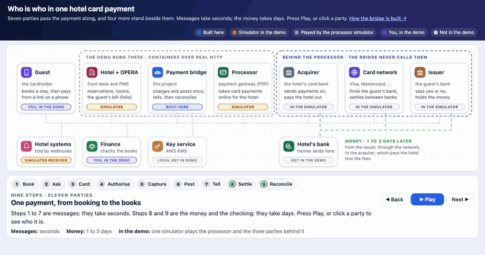
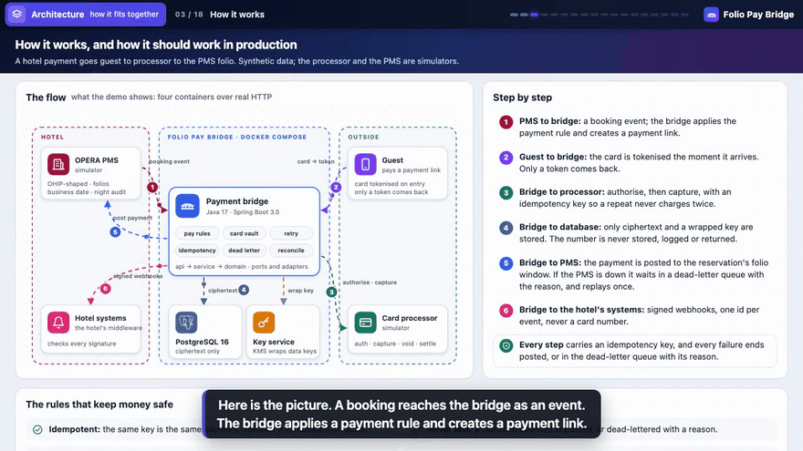

# Folio Pay Bridge

**Hotel payments, end to end, in one small production-shaped service:** take a booking or a payment request, charge the card exactly once, post the payment to the guest's folio in Oracle OPERA exactly once, tell the integrator by signed webhook, and reconcile the acquirer's settlement afterwards. Card numbers are tokenised with envelope encryption under AWS KMS and never reach a log.

Java 17 · Spring Boot 3.5 · Spring Security (OAuth2 resource server) · Spring Data JPA / Hibernate · PostgreSQL + Flyway · Resilience4j · AWS SDK (KMS) · React + TypeScript operator dashboard · Docker on Amazon Linux 2023 (Corretto 17).

Built as a work sample for an **AI-first Senior Java Engineer (payments)** role, with Claude Code agents directed by a written brief ([`CLAUDE.md`](CLAUDE.md)) and every change reviewed and proved by a person. **Synthetic data only**: public test card numbers, an OPERA-shaped simulator and a processor simulator. Not any company's software; no PCI certification is claimed.

---

## Start here: pick your path
| You are | Start with | Time |
|---|---|---|
| **New to card payments, or to software** | [Who is who: how a hotel gets paid](docs/who-is-who.md): the eleven parties, one payment in nine steps, what is real here and what is played. Then the [video](../../releases/latest) | 15 minutes, nothing to install |
| **An engineer joining** | [Onboarding](docs/onboarding.md): run it in the first hour, then five sessions that read, run and break each part on purpose | 1 hour, then 5 sessions |
| **A reviewer** | [What is proven, and by which test](#what-is-proven-and-by-which-test), then [Honest limits](#honest-limits-read-before-you-trust-it) | 10 minutes |



## Run it (5 minutes)
You need a JDK 17 and Docker.

```bash
git clone https://github.com/hhovhann/folio-pay-bridge && cd folio-pay-bridge
export JAVA_HOME=<path to a JDK 17>

# 1. Prove it: 557 backend tests + the dashboard's tests, coverage gate (99% lines, 90% branches), then the spec checker
./mvnw clean verify && python3 tools/check_specs.py

# 2. See the whole flow over real HTTP: bridge + PostgreSQL (Flyway) + OPERA simulator + processor simulator
docker compose up --build
#   who is who         http://127.0.0.1:8081/who-is-who.html   every party in one card payment, step by step (start here)
#   operator dashboard http://127.0.0.1:8081/dashboard/   overview, payments, links, webhooks, reconciliation
#   classic console   http://127.0.0.1:8081   the guest and fault switches used in the demo video
#   OPERA front desk  http://127.0.0.1:8090   reservations, folios, check-in and check-out, night audit, faults; received webhooks
#   processor         http://127.0.0.1:8091   ledger, settlement, faults

# or a single process with in-memory fakes and the console's fault switches
./mvnw spring-boot:run -Dspring-boot.run.profiles=demo
```

Then read, in this order: [`docs/who-is-who.md`](docs/who-is-who.md) (every party, in plain words) → [`docs/architecture.md`](docs/architecture.md) (how it works, why, and a glossary of every hotel-payments term) → [`specs/decisions.md`](specs/decisions.md) (D-1 to D-42) → [`SECURITY.md`](SECURITY.md) → [`docs/product-map.md`](docs/product-map.md) (what is built, simulated, missing). Before changing code: [`docs/engineering-standards.md`](docs/engineering-standards.md), how code is written here and the mistake behind each rule.

### Call the API like an integrator
Outside the demo profiles every `/api` call needs credentials (the app refuses to start with a real gateway and none configured).

```bash
# an API key for a PMS middleware that may send bookings and read results (the key is printed once; only its hash is configured)
python3 tools/new_api_key.py pms-middleware "bookings:write payments:read"
# start with:  FOLIOPAY_AUTH_API_KEYS='<the configuration line it printed>'
curl -H "X-Api-Key: fpb_test_..." http://127.0.0.1:8081/api/v1/links

# or OAuth2 client credentials (preferred): point the bridge at your authorization server (Cognito, Okta, Keycloak)
#   FOLIOPAY_AUTH_JWT_JWK_SET_URI, FOLIOPAY_AUTH_JWT_ISSUER, and FOLIOPAY_AUTH_JWT_AUDIENCE and/or FOLIOPAY_AUTH_JWT_SCOPE_PREFIX
#   (Cognito sets no audience on client-credentials tokens: use the scope prefix, its resource server id)
curl -H "Authorization: Bearer <access token>" http://127.0.0.1:8081/api/v1/charges
```
Scopes: `cards:write`, `payments:write`, `links:write`, `bookings:write`, `payments:read`, `operations`. The full API is in [`docs/openapi.json`](docs/openapi.json) (Swagger UI at `/swagger-ui/index.html` in the demo profiles).

### API conventions
- **Versioned in the path:** everything is under `/api/v1`. A version only grows (new endpoints, optional fields, enum values); a breaking change is `/api/v2` served beside it, and the old endpoint answers with `Deprecation`, `Sunset` and a successor `Link` until its sunset date (D-39).
- **Errors** are RFC 9457 problem details (`application/problem+json`) with a stable `code`; retryable ones carry `Retry-After` (D-29).
- **Idempotency keys are per client:** repeat a request with the same key and you get the first result, never a second charge; another client's identical key is another payment (D-40).
- **Logs:** every state change at INFO, the decisions in between at DEBUG, never a card number or a card token; one JSON object per line in production (`LOGGING_CONFIG=classpath:logback-json.xml`) (D-41).

## What it does
| Capability | How |
|---|---|
| **Payment links from bookings** | PMS booking events (new, modified, cancelled) become payment requests under the booking policy; one live request per booking; a link can be paid by one card at a time |
| **Payment requests from any app** | `POST /api/v1/links` with the `links:write` scope: F&B, events, spa or a messaging app asks for a set amount by a due date, and cannot take money itself |
| **Card charging, exactly once** | Tokenised card, authorise then capture, idempotency key on every processor call, the same key on every retry; a refused capture releases the hold |
| **Posting to OPERA, exactly once** | On Oracle's published OHIP contract (`postBillingPayment`, `getFolio`, `getBusinessDate`, OAuth client credentials), checked exchange by exchange against Oracle's own Swagger files (D-42): to the reservation's folio window with the hotel's payment method and the bridge's cashier; reads the folio before posting again (OPERA does not deduplicate); a lease stops two requests posting at once; failures are dead-lettered with a reason and replayable |
| **Integrator notifications** | Signed (HMAC-SHA256) webhooks for captured, declined, posted, dead-lettered; derived from stored state, retried, never dropped |
| **Revenue assurance** | Reconciliation of the acquirer's settlement against captures and postings, by period and per currency, with named exceptions |
| **Operator dashboard** | React + TypeScript single page at `/dashboard/`: money captured today per currency, every queue that needs a person, payments with their folio status and Replay, new payment requests, webhooks with redeliver, reconciliation by period; light and dark; OpenID Connect sign-in in production |
| **Shadow mode** | Runs the new rules beside a legacy stand-in on the same bookings and lists every difference before a hotel moves over |

## What is proven, and by which test
| Claim | Test that fails if it is false |
|---|---|
| The card number is in no database column, no log line (raw events, before masking), no response, no webhook | `PciIntegrationTest`, `OpenApiContractTest`, `NotificationServiceImplTest`, `WebhookIntegrationTest` |
| A ciphertext cannot be moved to another token; a card stays readable after the KMS alias moves | `CardVaultImplTest`, `CryptoTest`, `KmsKeyServiceTest` |
| A repeated or raced payment leaves one charge, one capture, one posting, one folio entry | `PaymentFlowIntegrationTest`, `ReviewFindingsIntegrationTest`, `IdempotentStoreTest` |
| Two integrators using the same idempotency key get two payments, neither able to read the other's | `SecurityIntegrationTest.twoClientsUsingTheSameIdempotencyKeyGetTwoSeparatePayments` |
| A credential problem (ours) never declines a card or rejects a folio for good: it waits, replayable | `HttpAdapterRepliesTest`, `HttpAdaptersTest`, `ChargeServiceImplTest` |
| Parallel replays reach OPERA once (eight posts without the lease) | `FullFlowHttpIntegrationTest.parallelReplaysAgainstANonDeduplicatingOperaPostOnce` |
| A processor refusal releases the hold; an unknown error never loses the charge | `ChargeServiceImplTest`, `HttpAdapterRepliesTest` |
| Expired, wrong-audience, wrong-issuer, ID or forged tokens are refused; Cognito access tokens are accepted; scopes limit every client, and asking for money is not taking it | `SecurityIntegrationTest` (a real RSA-signed JWT and a JWKS server), `SecurityConfigTest` |
| Webhooks are signed, delivered once per event across two relays, retried, and never carry card data | `WebhookIntegrationTest`, `WebhookSignatureTest` |
| Reconciliation is per period and per currency | `ReconciliationServiceImplTest` |
| The app refuses to start unsafe (no keys, no gateway, no auth with a real gateway, KMS on an in-memory database, weak webhook secret) | `FailClosedStartupTest`, `KeyModeGuardTest`, `WebhookIntegrationTest` |
| The dashboard renders real data, replays a posting and creates a request in a real browser, with no browser error and no content security policy violation | `demo/check_dashboard.py` (Playwright against the running app), the dashboard's Vitest tests |
| The schema is the reviewed migrations, and the entities match it | Flyway `V1__baseline.sql`, `V2__...sql` (per-client keys, change times, foreign keys) + `ddl-auto=validate`, run on PostgreSQL 16 in Compose |
| The layers stay layers: no controller reaches a repository, no service reaches HTTP, the domain knows no Spring, money is never floating point | `ArchitectureTest` |
| Logs at DEBUG carry no card number and no card token; production JSON logs are masked | `PciIntegrationTest`, `JsonLogConfigTest` |
| No type prints a secret, nothing holds a CVV, no log call gets a raw body or an exception's message, and card tokens, credentials and secret fields are masked at every boundary | `SensitiveTypesTest`, `CleanCodeTest`, `LogRedactorTest`, `HttpAdapterRepliesTest` |
| Refused credentials and scopes, every state-changing call, every card stored, opened or purged and every payment outcome are audited, and the trail cannot be switched off (PCI DSS 10.2) | `AuditTrailIntegrationTest`, `FailClosedStartupTest` |
| A card number unused for 90 days is destroyed, never one with a payment pending (PCI DSS 3.2.1) | `CardRetentionIntegrationTest` |
| OPERA, the processor and PostgreSQL are reached over verified TLS, or the app does not start (PCI DSS 4.2.1) | `TransportSecurityGuardTest` |
| Policy is configuration (a different deposit rule or back-off is applied); services log their entry; methods and classes stay small; services are `@Service`; only `crypto` encrypts | `PaymentRequestPolicyTest`, `WebhookPropertiesTest`, `CleanCodeTest`, `ArchitectureTest` |

**557 backend tests**, each named by a sentence that says what it proves, and 16 dashboard tests; backend coverage measured, not claimed: **99.4% of lines, 91.8% of branches** (JaCoCo, gate in `./mvnw verify`, `python3 tools/coverage.py` lists what is uncovered). The key tests were **mutation-checked**: each fix was broken on purpose and its test had to fail (39 of 39 in phase 14, 14 of 14 in the production-readiness review, 9 of 9 in the OHIP review's fixes, 11 of 11 in its cleanup, 14 of 14 in the final review, 26 of 26 in the safe-logs phase and its review). Every API operation is tested both succeeding and refused, counted from the requests the tests really send (`tools/check_specs.py`). [`docs/edge-cases.md`](docs/edge-cases.md) lists every edge case, its test, and what is not covered.

## Honest limits (read before you trust it)
- **Simulators, not integrations.** No real OPERA Cloud (OHIP) or acquirer. OPERA cannot be run locally by anyone (OPERA Cloud is Oracle's hosted service; OPERA 5 is licensed to hotels), so the OPERA side follows Oracle's published contract and a test holds the adapter and the simulator to it; what the contract leaves open is a list of questions for the first sandbox session (`specs/roadmap.md`). Running for real needs OHIP partner access, which comes with the employer, and an acquirer's test environment.
- **One property per deployment.** Multi-tenancy (operators, properties, per-tenant credentials and webhooks, data residency) is designed in `docs/architecture.md`, not built.
- **PCI DSS v4.0.1 is mapped, not certified.** `SECURITY.md` lists each requirement the code can hold with its control and test, and says which belong to the deployment or the organisation. The bridge receives card numbers, so it is in card-data scope until card entry moves to the acquirer's hosted fields.
- **Not built:** 3-D Secure and a hosted payment page, guest messaging, chargeback handling, a sweeper for payments stranded by a crash between two steps. See `docs/product-map.md`.
- **Not yet run against real AWS:** KMS (stubbed client), Cognito and the deployment runbook. Steps to close: `docs/aws-deployment.md` section 5.
- **Tests run on H2, not PostgreSQL.** The migrations, foreign keys and PostgreSQL's locking are exercised in the Compose stack, not in `./mvnw verify`; Testcontainers would close that (a test dependency, proposed, not added).
- **No rate limiting in the service** (card testing): it belongs in front of it (AWS WAF rate rules), and the ledger lists return the newest 500 rows with no cursor.

## Map of the repository
| Path | What |
|---|---|
| `src/main/java/dev/foliopay` | The service: `api` → `service` → `domain`, `repository`, `gateway` (ports, HTTP adapters, fakes), `crypto`, `config` (security, retries, filters, webhook relay) |
| `src/main/java/dev/foliopaysim` | OPERA and processor simulators (same jar, different main class) |
| `src/main/resources/db/migration` | Flyway migrations |
| `dashboard/` | The frontend: the operator dashboard, a React + TypeScript single-page app (Vite). It calls only the public API, and Maven builds, tests and packs it into the jar, served at `/dashboard/` |
| `src/main/resources/static` | The classic console the demo video drives (fault switches, the guest's view); outside the demo profiles `/` goes to the dashboard |
| `specs/` | Mission, tech stack, decisions, and one folder per phase (requirements, plan, validation with the test that proves each box) |
| `docs/` | Engineering standards, architecture and glossary, product map, AWS runbook, edge cases, agent log, OpenAPI |
| `tools/` | Spec checker, coverage report, card-number and secret guard, command guard (no force-push or remote deletion by an agent), API key generator |
| `demo/` | Scripts that drive the real app with Playwright: the narrated video (asserting every line against the screen) and the dashboard's browser check |
| `.claude/settings.json` | AI guardrails for Claude Code: hooks that block card numbers, secrets and history-rewriting commands, permission rules |

## How it was built (AI-first, reviewed by a person)
Specs first (`specs/`), one phase at a time, test before code, a box ticked only when the named test passed (`tools/check_specs.py` checks the surefire reports). Claude Code agents wrote most of the code from the brief in `CLAUDE.md`; every change was read, run and, for the risky ones, mutation-checked. Independent reviews by other models found real bugs (a paid link could be paid again by another card; parallel replays could double-post to OPERA; a refused capture left a card hold in place), each fixed with a test that fails without the fix. [`docs/agent-log.md`](docs/agent-log.md) lists what the agents got wrong and how each was caught, and every entry is cited by the rule or test in [`docs/engineering-standards.md`](docs/engineering-standards.md) that now prevents it (`tools/check_specs.py` fails otherwise), which `CLAUDE.md` loads into every agent session. The AI guardrails are enforced, not only written: a hook stops an agent writing a card number or secret, and CI runs the same check.

## Deploying on AWS
[`docs/aws-deployment.md`](docs/aws-deployment.md): VPC, KMS, RDS PostgreSQL, Secrets Manager, ECS on Amazon Linux 2023, OAuth2 with Cognito, the midnight-to-3am deployment window, and a going-live checklist. OPERA Cloud is Oracle's SaaS, called over HTTPS, not something you run in AWS. Not yet executed in a real account.

## Demo video
One narrated full-flow video (about eight minutes, captions burned in, 19 chapters): the problem the bridge solves, who is who in a card payment (each party, the acquirer, the card network and the issuer included, lit as the voice names it), the architecture with each step of the flow lit as the voice explains it, the four containers over real HTTP, the happy path with signed webhooks, then a lost reply, an outage and replay, a declined capture, night audit with an expired token, reconciliation, masked logs, the measured proof, and the production target on AWS, including how OPERA Cloud's events would arrive on OHIP's Streaming API (not built here). Re-recorded from the running app with `demo/make_fullflow_demo.py`, which first asserts every narrated claim against the screen; the numbers on its proof card are read from the build's own reports. The overlay (top bar, chapter titles, cards) is `demo/overlay.js`; `DEMO_FAST=1 DEMO_SHOTS=<dir>` saves a still per scene without recording. The GIF at the top is the who-is-who page itself, made and checked scene by scene by `demo/make_who_gif.py`. Captions are in [`demo/out`](demo/out); the video is attached to the [GitHub release](../../releases/latest), not committed.


