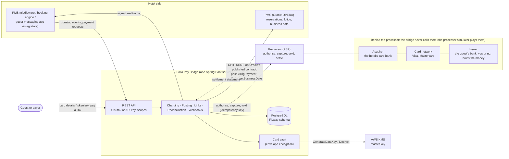

# Architecture: how Folio Pay Bridge works, and why it is built this way

This page is for an engineer joining the project. It explains what the system does, how one payment travels through it, why it is one service and not many, and what every hotel-payments term means. The decisions behind each choice are numbered in [`specs/decisions.md`](../specs/decisions.md) (D-1 to D-42); this page links to them instead of repeating them. New to card payments? Read [`who-is-who.md`](who-is-who.md) first: every party, in plain words.

## 1. The problem in one paragraph
A hotel has to get paid when the guest is not standing at the desk: a deposit for an advance-purchase booking, a virtual card an online travel agent (OTA) sends with the reservation, a brunch for four, a gala dinner. The money moves through the hotel's own **acquirer** (its bank for cards) via a **payment service provider (PSP)**, and the payment must then appear on the guest's bill in the hotel's **property management system (PMS)**, usually **Oracle OPERA**, so the front desk, night audit and finance all see it. Folio Pay Bridge sits between those systems: it takes the request, charges the card exactly once, posts the payment to the right folio exactly once, tells the integrator what happened, and later checks the acquirer's settlement against what it captured. Card numbers are encrypted with keys held in AWS KMS and never appear in logs.

## 2. The actors

The processor is the only card-side system the bridge talks to. An authorisation travels on from the processor to the acquirer, the card network and the issuer, and back, in about two seconds; the money follows one to three days later, at settlement. In the demo one simulator answers for all four, and its ledger names the network and the issuer's approval code.

## 3. One payment, end to end
The happy path, then what happens when each step fails.

```mermaid
sequenceDiagram
  autonumber
  participant MW as PMS middleware
  participant B as Bridge
  participant K as AWS KMS
  participant P as PSP / acquirer
  participant O as OPERA (OHIP)
  MW->>B: POST /api/v1/booking-events (NEW, rate plan, arrival, total)
  B->>B: policy decides the deposit and due date, stores an OPEN payment link
  Note over B: the guest opens the link
  B->>K: GenerateDataKey (context: token id)
  K-->>B: plaintext data key + wrapped copy + key ARN
  B->>B: AES-256-GCM encrypt the card number, store ciphertext + wrapped key + ARN, drop the plaintext key
  B-->>MW: card token (tok_...)
  MW->>B: POST /api/v1/links/{id}/pay (token)
  B->>B: claim the link for this card (atomic OPEN to PAYING)
  B->>O: getBusinessDate for the hotel
  B->>B: store charge PENDING under a unique idempotency key
  B->>K: Decrypt wrapped key (context must match)
  B->>P: authorise (key:auth, card number), card number dropped right after
  B->>P: capture (key:cap)
  B->>B: charge CAPTURED, link PAID
  B->>B: store posting PENDING (post:chargeId), take the lease
  B->>O: getFolio: a payment with reference post:chargeId? (none yet)
  B->>O: postBillingPayment to the folio window (payment method, cashier, reference); OPERA posts it on its business date
  O-->>B: transaction number
  B->>B: posting POSTED
  B-->>MW: outcome OK
  B--)MW: webhook payment.captured, then folio.posted (signed, retried until delivered)
```

| What goes wrong | What the bridge does | Decision |
|---|---|---|
| The client sends the same request twice, or two at once | The unique idempotency key in the database lets one row exist; the twin reads it and returns the same result | D-2, D-16 |
| The processor's reply is lost (timeout) | Retry with the **same** key: the processor answers with the first result instead of charging again. A timeout is "unknown", never "failed" | D-3, D-27 |
| The card is declined | DECLINED, final, link given back for another card | D-4 |
| The processor refuses the request itself (amount mismatch, unknown authorisation, key reused) | Final like a decline, hold released, logged as an error for an operator | D-34 |
| Something we cannot classify | Charge stays PENDING and saved; hold kept, because the capture may have happened; a retry asks the processor again | D-34 |
| OPERA is down or slow | Retried with backoff, then **dead-lettered** with a reason: the captured money is never lost. An operator replays it later | D-5 |
| OPERA posted but its reply was lost | Every attempt first looks for its own reference, so the payment is found, not posted twice (OPERA does not deduplicate) | D-23 |
| Two replays at once | A database lease lets one request talk to OPERA; it renews the lease before posting and stops if it lost it | D-28 |
| OPERA refuses the posting (folio closed) | Dead-lettered as REJECTED_BY_OPERA; never retried automatically, a person fixes the folio | D-5 |
| Night audit runs while a charge is pending | The retry keeps the charge's own business date | D-21 |
| The integrator's webhook endpoint is down | Retried with growing waits (30 s ... 1 h), then FAILED and visible; an operator redelivers | D-35 |

## 4. Why one service (a modular monolith), and when to split
**Scale first.** A large hotel-payments platform serves a few hundred properties and over a hundred thousand rooms in dozens of countries, which works out to a few million payment requests over several years. Even at ten times that volume it is a few payments per second at the busiest minute. A single Spring Boot service on PostgreSQL handles hundreds per second; the database is not the limit.

**What is hard here is correctness, not throughput.** Exactly-once charging, exactly-once posting, never losing a captured payment: these rest on **database transactions and unique constraints**. Inside one service with one database they are a `unique` index and a conditional `update`. Split into microservices, the same guarantees need sagas, outboxes on every hop and distributed tracing to debug, all to solve a scaling problem that does not exist.

**So:** one deployable, with strict internal layers (below) so it can be split later along the seams that already exist. Run two or more instances behind a load balancer for availability; every concurrency rule is in the database, so instances need no coordination of their own.

**Split when** (and only then): a part needs a different security boundary (the card vault is the first candidate: a smaller PCI scope if only it ever sees a card number), a part needs to scale or deploy on a different rhythm (reconciliation batch jobs, a high-volume webhook fan-out), or teams need to own parts independently.

## 5. Inside the service: layers
```
api          controllers, DTOs, one @RestControllerAdvice      (HTTP only: never touches a repository)
  -> service       use-case interfaces                          (never touches HTTP)
     service.impl  package-private implementations
  -> domain        entities, Money, pure rules, exceptions      (no Spring except JPA annotations)
  -> repository    Spring Data JPA
  -> gateway       ports PspClient, OperaClient, WebhookSender; gateway.http (real adapters), gateway.fake (tests, demo)
  -> crypto        KeyService: KMS in production, a local key for demos
config           security (OAuth2 + API keys), Resilience4j retries, filters, the webhook relay
dashboard/       the operator dashboard: React + TypeScript single page, built into the jar, served at /dashboard/ (D-38)
```
Ports and adapters (hexagonal) at the edges: a different acquirer or OPERA 5 instead of OPERA Cloud is a new adapter behind the same interface, and the core does not change. Each rule has a unit test with test doubles; an integration test exists only for what needs a real database or real HTTP. See D-14.

### The operator dashboard
A single page (`/dashboard/`) for the people who run payments: an overview of money captured today per currency and every queue that needs a person (pending charges, postings waiting for OPERA or rejected by it, failed webhooks), the payments with their folio status and a Replay button, payment links with a form for new requests, the webhook log with redeliver, and reconciliation by period. It uses only the public API, with the same scopes as any client, so it can never do more than an integrator with the same rights. Its figures come from `GET /api/v1/overview`, computed with count and sum queries in the database. In production people sign in at the company's identity provider (OpenID Connect with PKCE). The classic console at `/` remains for the recorded demo.

## 6. Card data: envelope encryption with AWS KMS
- **Tokenisation.** The card number (PAN) arrives once, at `POST /api/v1/cards`. The bridge returns a token (`tok_...`) and stores only: the ciphertext, the wrapped data key, the KMS key ARN, the first six and last four digits, and the expiry. Never the PAN, never the CVV.
- **Envelope encryption.** KMS keeps a master key that never leaves it. For each card the bridge asks KMS for a fresh 256-bit **data key**: it gets the key in plain and a copy encrypted ("wrapped") by the master key. It encrypts the PAN locally with AES-256-GCM, stores the wrapped copy beside the ciphertext, and throws the plain key away. To read the card it sends the wrapped key back to KMS to unwrap. Why: KMS is only ever asked to handle 32-byte keys, one key compromise exposes one card, and every unwrap is a CloudTrail event.
- **Encryption context.** Each KMS call carries `{"token": "tok_..."}`. KMS refuses to unwrap with a different context, and the IAM policy can require it, so a stolen wrapped key cannot be opened under another token. The same token id is the AES-GCM associated data, so a ciphertext moved to another row fails to decrypt.
- **Lent, not handed out.** `CardVault.withCard(token, fn)` decrypts, calls `fn`, then zeroes the buffers. The only production caller is the processor adapter; retries happen outside it, so the card is not in memory while a retry waits (D-6, D-15).
- **Logs.** Code never logs a PAN, a card token, a credential, a raw body or an exception's message. A type that holds a secret prints a redacted `toString()`. `LogRedactor` masks what slips through anyway, at every boundary: both log formats, stack traces, the log context, the console's recent lines, and error codes from OPERA and the processor (D-8, D-24, D-41).
- **Audit trail.** Refused credentials and scopes, every state-changing call, each card stored, opened or purged, each payment outcome and the configuration in force go to the logger `dev.foliopay.audit`, which cannot be switched off. A card is named by a fingerprint, never its token (D-43).
- **Retention.** A card unused for 90 days (configurable) loses its ciphertext and wrapped key; the row stays so the charges that name it stay valid. A card with a payment pending is never purged (D-44).
- **Transport.** OPERA and the processor over `https`, PostgreSQL with `sslmode=verify-full`, or the application does not start (D-45).
- **Key rotation.** KMS automatic rotation keeps old key material, so nothing changes. If ops move the alias to a new key, each token still names the ARN that wrapped it (D-31).

## 7. Security model
OAuth2 client credentials (JWT checked against the authorization server's JWKS: signature, issuer, audience, expiry) or hashed API keys, with scopes per endpoint; fails closed; stateless. Full table in [`SECURITY.md`](../SECURITY.md). AI guardrails (D-36) are enforced by a Claude Code hook and CI, not only written in `CLAUDE.md`.

## 8. Data model (PostgreSQL, Flyway `V1__baseline.sql`)
| Table | One row is | Key guarantee |
|---|---|---|
| `card_token` | an encrypted card | no PAN column exists |
| `charge` | an attempt to take money | `unique(idempotency_key)`; `@Version` optimistic lock; status only moves forward (PENDING < DECLINED < CAPTURED) |
| `posting` | a captured payment on its way to a folio | `unique(idempotency_key = post:<chargeId>)`; lease columns; POSTED or DEAD_LETTER with a category |
| `payment_link` | a request to pay | `unique(open_slot)`: at most one live link per booking; atomic claim per card |
| `notification` | a webhook event | `unique(event_id)`; derived from the rows above, so it cannot be lost by a crash |

## 9. Multi-tenancy: the next phase (designed, not built)
Today one deployment serves one property (`foliopay.opera.hotel-id`). A platform for hundreds of properties across many operators needs:
1. **A tenant on everything**: `operator_id` and `property_id` columns on every table and in every unique key (`unique(property_id, idempotency_key)`), with every query scoped. PostgreSQL row-level security as a second line.
2. **Tenant-bound credentials**: a token's `client_id` (or an API key) maps to the properties it may act for; the check happens before any service call. "Each team receives only its own notifications" becomes a webhook endpoint and secret per tenant.
3. **Per-property settings in the database**, not in properties files: OPERA hotel id, folio window, payment codes, cashier, deposit policy, acquirer and its credentials (in Secrets Manager, referenced by ARN). "Every deployment is shaped around the property."
4. **The tenant in the KMS encryption context** (`{"token": ..., "property": ...}`), and optionally a KMS key per operator, so one operator's data cannot be unwrapped in another's context.
5. **Data residency**: properties in the EU (GDPR) and the GCC may need their card data in-region: a deployment (and KMS key) per region, routed by property.

## 10. What is simulated and what is real
Real: the Java service, its database rules, the operator dashboard (checked in a real browser against the running app), encryption with a real AES-GCM implementation, the HTTP adapters (timeouts, OAuth refresh, idempotency headers, status mapping), Spring Security with real signed JWTs, Flyway on PostgreSQL 16, the Docker image on Amazon Linux 2023. Simulated: OPERA, by a simulator on Oracle's published OHIP contract for the four operations the bridge uses, held to Oracle's own Swagger files by `OhipContractTest` (D-42), with a front desk (reservations, folios, room charges, night audit, check-out); it is not Oracle software, and OPERA cannot be run locally by anyone. The processor, by a simulator shaped like a typical PSP, not a real API. KMS (tested against a stubbed client), the authorization server (a local JWKS in tests). Not built: 3-D Secure and a hosted payment page, messaging (email, SMS, WhatsApp), multi-tenancy, chargeback handling. See [`docs/product-map.md`](product-map.md).

## 11. Glossary
**Hotel side**
- **PMS (property management system):** the hotel's core system: reservations, rooms, guest bills, the business date. OPERA is the most common one in large hotels.
- **Oracle OPERA Cloud / OPERA 5:** Oracle's PMS. OPERA Cloud is Oracle's SaaS (hosted on Oracle Cloud Infrastructure); OPERA 5 (V5) is the older on-premise version. You never run OPERA yourself.
- **OHIP (Oracle Hospitality Integration Platform):** the REST API gateway to OPERA Cloud. Calls need an OAuth2 token (client credentials: client id and secret, an enterprise id and a scope), an application key (`x-app-key`) and the hotel id (`x-hotelid`). Oracle publishes the specifications at github.com/oracle/hospitality-api-docs; access is through Oracle's developer portal, a shared partner sandbox (API only, billed per call) or a hotel's test environment. The APIs are grouped by module: `csh` cashiering (folios, payments, charges), `bof` back office (business date), `rsv` reservations, `fof` front desk (check-in, rooms).
- **OPERA 5 interfaces:** OXI (XML messages for reservations and profiles), OWS (SOAP web services), IFC8 (postings from POS and payment systems). New integrations target OHIP; an OPERA 5 hotel would be another adapter behind the same port.
- **OPI (OPERA Payment Interface):** Oracle's own link between OPERA and card terminals and payment providers. For some hotels Oracle's payment offer is an alternative to a payment company's, so it is worth knowing where each fits.
- **Reservation:** a booking in the PMS. **Folio:** the guest's bill on a reservation. **Folio window:** one of several sub-bills on a folio (window 1 for the guest, window 2 for the company, for example). A payment is posted to a window.
- **Payment method / transaction code:** how OPERA classifies a posting (a payment method such as `CC`, or one per card brand; transaction codes such as `1000` for a room charge). **Cashier:** the numbered user or interface a posting is made under; finance closes cashiers at the end of the day. The bridge posts as its own interface cashier.
- **Transaction type:** OHIP's `Revenue` (a charge on the folio) or `Payment`. **Balance:** charges minus payments per window; a guest checks out with every window at zero.
- **Business date / night audit:** the hotel's accounting day. It does not change at midnight but when the night auditor closes the day (often 2 to 4 am), which also posts room and tax to every guest in house. OPERA posts every charge and payment on the open business date: an integration does not choose it, but must know it, because a payment charged before night audit and posted after it lands on the next day.
- **Rate plan:** the commercial terms of a booking. **Advance purchase:** non-refundable, paid up front. **Flexible:** a deposit or nothing until near arrival. The bridge's policy turns these into a payment request and due date.
- **OTA (online travel agent):** Booking.com, Expedia and the like. **VCC (virtual credit card):** a single-use card an OTA issues to pay the hotel for a booking; the hotel charges it like any card, often after arrival. Charging VCCs without manual keying is the flow this project is built around.

**Card payments**
- **PAN:** primary account number (the card number). **BIN / IIN:** its first six to eight digits, identifying the issuer. **CVV:** the security code, which may never be stored.
- **PCI DSS:** the card industry's security standard. Any system that stores, processes or transmits a PAN is in scope; tokenisation and encryption shrink that scope.
- **Issuer:** the cardholder's bank. **Acquirer:** the hotel's bank for card payments; it is paid by the issuer through the card scheme (Visa, Mastercard). **PSP / payment gateway:** the provider the hotel connects to, which talks to the acquirer. "Acquirer independent" means the hotel keeps its own acquirer and the bridge adapts to it.
- **Authorisation:** the issuer reserves the amount (a hold). **Capture:** the hold is turned into a charge. **Void:** the hold is released without charging. **Refund:** money is returned after capture.
- **Settlement:** the acquirer pays the hotel, usually a day or more later, and sends a **settlement statement** listing what was paid. **Reconciliation:** matching that statement against what was captured and what was posted to the PMS (missing, short, duplicated, unknown, wrong currency, not posted).
- **Chargeback / dispute:** the cardholder disputes a payment through the issuer; the hotel must defend it with evidence (booking terms accepted, 3-D Secure result). **3-D Secure (3DS):** the issuer authenticates the cardholder during an online payment, which shifts fraud liability away from the hotel.
- **Minor units:** amounts as whole numbers of the smallest unit (cents, fils). Most currencies have two decimals, JPY none, KWD three (D-1).

**Engineering**
- **Idempotency key:** a client-chosen id for a request; sending it again returns the first result instead of acting twice. The core of "exactly once".
- **Optimistic locking:** each row has a version; an update that started from an older version fails instead of overwriting a newer state.
- **Lease:** a time-limited right, stored in the database, for one request to do one thing (talk to OPERA about one posting, send one webhook).
- **Dead-letter queue:** where work that could not be completed waits, with a reason, for a retry or a person, instead of being dropped.
- **Webhook:** an HTTP call from the bridge to the integrator when something happens. **HMAC signature:** a hash of the message keyed with a shared secret, so the receiver knows it came from the bridge and was not altered. **At least once:** an event may arrive twice (the receiver deduplicates by event id), but never zero times.
- **Outbox (here: state-derived):** events are produced from what the database already records, so there is no separate write a crash could lose.
- **OAuth2 client credentials:** a machine-to-machine login: the client trades its id and secret at the authorization server for a short-lived token. **JWT:** the signed token. **JWKS:** the authorization server's published public keys, used to check the signature. **Scope:** a permission in the token. **Resource server:** the API that accepts the token (here, the bridge).
- **Envelope encryption, data key, master key, encryption context:** see section 6.
- **AES-256-GCM:** authenticated encryption: it detects tampering. **AAD (associated data):** extra data bound to a ciphertext without being encrypted (here the token id).
- **Flyway:** versioned SQL migrations applied before the application uses the schema. **`ddl-auto=validate`:** Hibernate checks the entities match the schema and changes nothing.
- **Luhn check:** the checksum digit every card number carries; used to spot card numbers in text.
- **MDC (mapped diagnostic context):** per-request values (request id, client) added to every log line.
- **Shadow mode:** running the new rules beside a legacy system on the same bookings and comparing results before switching over.
- **Fail closed:** when configuration is missing or wrong, refuse to start rather than run in an unsafe default.
