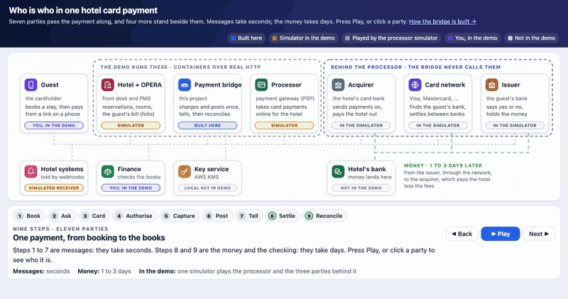

# Who is who: how a hotel gets paid by card

For anyone new to card payments or to software. It takes ten minutes, and there is nothing to install. The same story is on an interactive page, `/who-is-who.html`, which the bridge serves when the demo runs: press Play, or click a party. It is also the third chapter of the [demo video](../../../releases/latest).



## In three sentences
When a guest pays a hotel by card, seven parties pass the payment along. The guest's own bank says yes and holds the money in about two seconds, but the money reaches the hotel one to three days later, less fees. This project, the **payment bridge**, sits in the middle. It charges the card once, writes the payment on the guest's bill once, and checks afterwards that the money that arrived matches.

## The parties
| Party | In one line | Sees of the card | In this project's demo |
|---|---|---|---|
| **Guest** (the cardholder) | Books a stay and pays, often from a link on a phone | Their own card | You, in the bridge console |
| **Hotel + OPERA** (front desk and PMS) | The property management system holds the reservations, the rooms and each guest's bill, the **folio** | The amount, a reference, the last four digits | A simulator of OPERA, built on Oracle's published contract (not Oracle software) |
| **Payment bridge** (this project) | Turns a booking into a payment request, charges the card exactly once, posts the payment to the folio exactly once, tells the hotel's systems, reconciles | The number once, encrypted on arrival, never logged | **The real code** in this repository |
| **Processor** (payment gateway, PSP) | The company the hotel signs with to take cards online; it passes requests on and returns the answer | The full number | A simulator, which also plays the three parties below |
| **Acquirer** (the hotel's card bank) | Sends the hotel's payments into the card network, and pays the hotel what was collected, less fees | The full number | Played by the processor simulator |
| **Card network** (Visa, Mastercard and so on) | The rails between all the banks: finds the guest's bank by the card's first digits, and settles money between banks each day | The full number | Played by the processor simulator, which names the network from the first digit |
| **Issuer** (the guest's bank) | Gave the guest the card. It says yes or no and holds the money on yes. A booking site's virtual card has an issuer too | The full number (it is its own card) | Played by the processor simulator, which approves with a code |
| **Hotel systems** | The hotel's middleware or apps, told what happened by signed messages (webhooks) | Never the number | The OPERA simulator receives the messages |
| **Finance** | The hotel's accountants: what was charged, paid out and billed must agree | Never the number | You, with the "Reconcile" buttons |
| **Key service** (AWS KMS) | A locked box for the keys that encrypt card numbers; its master key never leaves it | Never the number | A local key (the KMS code is tested against a stand-in) |
| **Hotel's bank account** | Where the money finally lands | Never the number | Not shown: the demo shows the statement |

When the booking came from a booking site (an online travel agent), the site often pays the hotel with a **virtual card** made for that one booking. The hotel charges it like any card. Its issuer is the bank behind the virtual card, and the rest of the chain is the same.

## One payment, step by step
```mermaid
sequenceDiagram
  autonumber
  actor G as Guest
  participant H as Hotel + OPERA
  participant B as Payment bridge
  participant P as Processor
  participant A as Acquirer
  participant N as Card network
  participant I as Issuer (guest's bank)
  G->>H: books a stay
  H->>B: booking event
  B->>G: payment link: 800 USD within 24 hours
  G->>B: card number (encrypted at once; a token comes back)
  B->>P: authorise 800 USD
  P->>A: passes it on
  A->>N: passes it on
  N->>I: can this card pay 800 USD?
  I-->>B: yes: held, approval code (back the same way)
  B->>P: capture: take the 800 USD
  P-->>B: captured (the same route)
  B->>H: the payment goes on the guest's folio
  B--)H: signed webhook: payment captured, posted
  Note over A,I: one to three days later: settlement
  I->>N: the money for the day's payments
  N->>A: passes it on
  A->>H: pays the hotel's bank account, less fees
  A-->>B: settlement statement (through the processor)
  B->>B: reconcile: statement = captures = folio
```

1. **Book.** The guest books. OPERA records the reservation and tells the bridge.
2. **Ask.** The bridge applies the hotel's rule, for example "the full amount within 24 hours" for a non-refundable rate, and sends a payment link.
3. **Card.** The guest enters the card. The bridge encrypts the number at once and keeps only a token.
4. **Authorise.** "Can this card pay 800 dollars?" The question goes from the processor to the acquirer, the network and the guest's bank, and the answer comes back in about two seconds. On yes, the money is **held**, not taken.
5. **Capture.** "Take the money that is held." The hotel is now owed the money. It has not arrived yet.
6. **Post.** The bridge writes the payment on the guest's folio in OPERA, so the front desk sees the stay paid.
7. **Tell.** The hotel's other systems get a signed message: payment captured, payment posted.
8. **Settle.** One to three days later the money really moves: from the guest's bank, through the network, to the acquirer, which pays the hotel less the fees, with a statement.
9. **Reconcile.** Finance checks that every capture was paid out and is on the right bill. The bridge does the matching and names every difference.

## Two speeds: messages and money
Steps 1 to 7 are **messages**, and each takes seconds. Step 8 is the **money**, and it takes days. Between the two, the hotel holds a promise, not cash. That is why reconciliation exists: a promise can be paid short, paid twice, or not at all.

## What can go wrong, and who handles it
| What happens | Who causes it | What the bridge does |
|---|---|---|
| The guest's bank says no (a **decline**) | Issuer | The link opens again, so the guest can try another card |
| An answer is lost on the way back | Any network in between | It asks again with the same **idempotency key**, and the processor returns its first answer instead of charging twice |
| OPERA is down after the card was charged | Hotel | The payment waits in a queue with the reason, and is posted once when OPERA is back |
| The statement misses a payment, or pays it short | Acquirer | Reconciliation names it: missing, short, or unknown |
| The guest disputes the payment with their bank (a **chargeback**) | Issuer, through the network | Not built yet: the evidence (booking terms, folio) would come from the bridge's records |

## What is real here, and what is played
- **Built and tested:** the payment bridge, its database rules, the card encryption, the operator dashboard.
- **Simulators, running as their own containers in the demo:** OPERA, and the processor.
- **Played by the processor simulator, not run:** the acquirer, the card network and the issuer. In real life they sit behind the processor, and the bridge never calls them. Its ledger shows what they would add: the network and the approval code.
- **Not here:** real money, real banks, a real OPERA Cloud. See [`product-map.md`](product-map.md).

## Words you will hear
- **Authorisation:** the bank holds the amount. **Capture:** the hold becomes a charge. **Void:** the hold is released without charging.
- **Settlement:** the money moves between banks, days later. **Reconciliation:** checking the statement against the records.
- **Folio:** the guest's bill in the PMS. **PMS:** the hotel's property management system (here, OPERA).
- **Token:** a stand-in for a card number, useless to a thief. **Idempotency key:** a request's id, so that sending it twice acts once.
- **Webhook:** a message one system sends another when something happens.

The full glossary, with the engineering terms, is in [`architecture.md`](architecture.md#11-glossary). To run the demo yourself, see the README. For an engineer joining, see [`onboarding.md`](onboarding.md).
